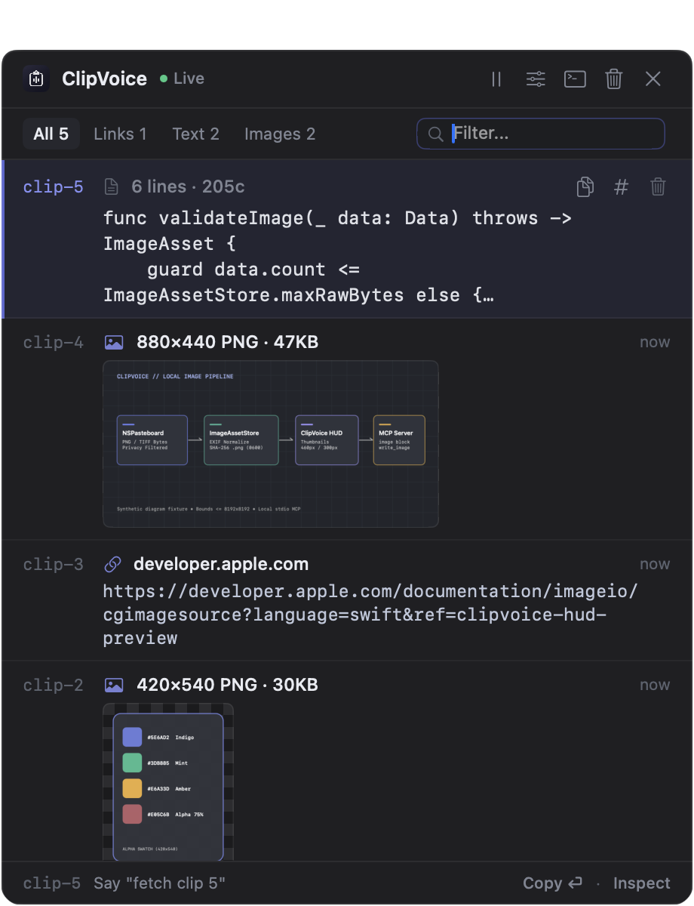
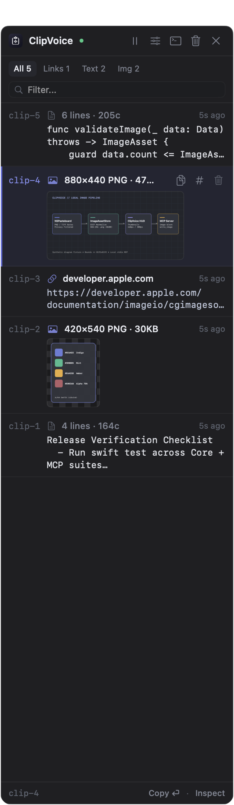
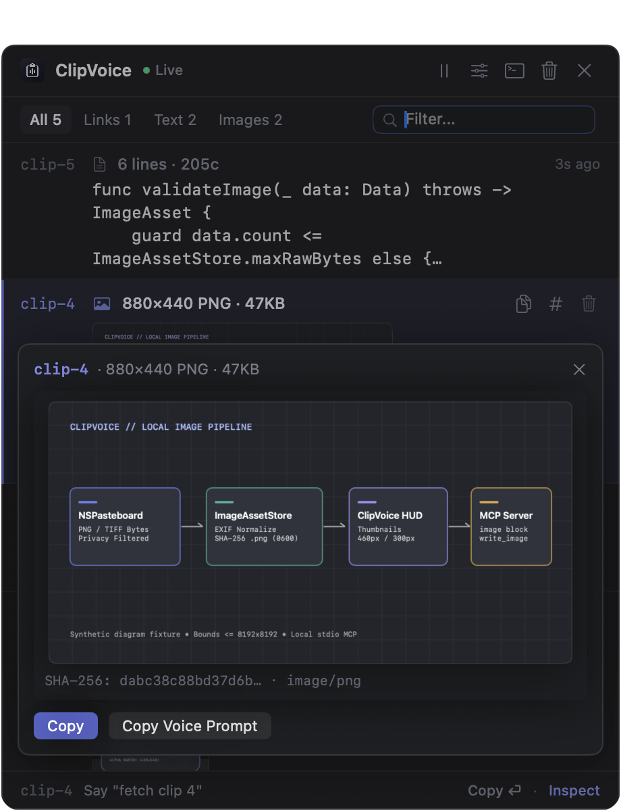
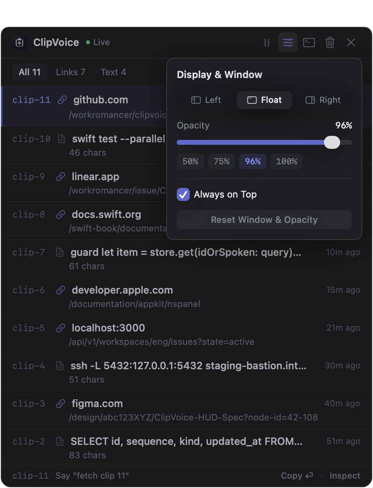

# ClipVoice

**Extend your clipboard with voice mode for coding agents.**

ClipVoice is a native macOS floating HUD, menu-bar utility, local stdio MCP server, CLI, and installable agent skill that gives every captured clipboard entry a **stable speakable ID** (`clip-1`, `clip-2`, ...).

When you are dictating to a coding agent in voice mode (Wispr Flow, Superwhisper, Mac Dictation, Codex/Claude voice mode), you no longer have to read long URLs aloud or guess which item was "the second one": glance at the floating HUD and say *"fetch clip 4"* or *"use the link in clip twelve"*, share copied screenshots or diagrams directly via MCP, or ask your agent to write text, URLs, or local PNG/image files onto your clipboard.

| Mixed Content & Images (`460×600`) | Slim Edge-Docked HUD (`300px`) |
| --- | --- |
|  |  |

| On-Demand Image Inspector | Display & Opacity Controls |
| --- | --- |
|  |  |

---

## Key Features

- **Stable Speakable Identifiers (`clip-1`, `clip-2`, ...)**: Every newly captured item gets a monotonic ID that **never shifts** when newer items arrive or when an existing item is re-copied or written again.
- **Voice-Friendly Lookup**: Agents and `clipvoice-cli` resolve canonical (`clip-12`), spaced (`clip 12`), numeric (`12`), and spoken number forms (`clip twelve`, `clip twenty four`).
- **Readable Multi-Line Previews & Clipboard Images**: Displays 3–4+ lines of actual text/code preserving line breaks and indentation (monospaced for code snippets), multi-line wrapped URLs beneath their domain header, and aspect-preserving PNG/TIFF thumbnails over a transparency checkerboard (`Images` tab filter + larger on-demand `Inspect` preview).
- **Compact Dark Floating HUD**: Linear-inspired dark charcoal native `NSPanel` with flat borderless rows, muted monospaced IDs, hover/selection row actions, free corner/edge resizing, Left/Float/Right dock presets and Opacity (`45%–100%`) in Display Settings, Always-on-Top pin, integrated filter/search (`⌘F`), adaptive slim mode (`270–320px`), on-demand detail inspector, and keyboard navigation (`↑`/`↓`, `⏎` Copy, `⌫` Delete, `Esc` Hide).
- **Subtle MCP Read & Incoming Write Indicators**: Displays a subtle ~5s indigo perimeter hairline and status badge on MCP read operations (`list_clips`, `get_clip`, `search_clips`, `get_latest_clip`, `resources/read`), plus a ~2s row entrance fade/slide and quiet `NEW`/`UPDATED` badge on explicit agent writes (`write_clip`, `write_image`, `write`, `write-image`; both respecting macOS Reduce Motion).
- **Agent Read & Write Support (Text, URLs & Images)**: Read via `list_clips`, `get_clip`, `search_clips`, `get_latest_clip` (returning standard MCP `image` PNG content blocks on `get_clip`/`get_latest_clip`), and write via `write_clip` / `write_image` (MCP) or `clipvoice-cli write` / `write-image` with cross-process `flock` locking, SHA-256 deduplication, and watcher suppression.
- **Multi-Language Support (i18n)**: Localized in English (`en`) and Korean (`ko`).

---

## Connecting Your Coding Agent

### 1. Local Stdio MCP Server

Add `clipvoice-mcp` to your MCP client configuration (see [examples/mcp-config.json](examples/mcp-config.json) and [examples/codex-config.toml](examples/codex-config.toml)):

**JSON (`Claude Desktop`, `Cursor`, `Antigravity`, etc.):**

```json
{
  "mcpServers": {
    "clipvoice": {
      "command": "/Applications/ClipVoice.app/Contents/MacOS/clipvoice-mcp",
      "args": []
    }
  }
}
```

**TOML (`~/.codex/config.toml`):**

```toml
[mcp_servers.clipvoice]
command = "/Applications/ClipVoice.app/Contents/MacOS/clipvoice-mcp"
args = []
```

**Exposed MCP Tools:**
- `list_clips(kind?, query?, limit?)` — List captured clips (`url`, `text`, `image`) newest-first with stable IDs and lightweight metadata/previews (no base64 image payloads).
- `get_clip(id)` — Fetch the exact full text/URL or, for image clips, metadata plus an MCP `image` content block (`image/png`) by stable/spoken ID (`"clip-4"`, `"clip four"`, `"4"`).
- `search_clips(query, kind?, limit?)` — Search by domain, keyword, image dimensions/hash, or ID.
- `get_latest_clip(kind?)` — Fetch the most recent URL, text, or image clip.
- `write_clip(content)` — *(Mutation)* Write text or an `http`/`https` URL to the macOS clipboard and record it in ClipVoice with a stable ID (only invoke upon explicit user request).
- `write_image(file_path)` — *(Mutation)* Validate a bounded local image file, normalize to canonical PNG, write it to the macOS clipboard (`public.png` + `public.tiff`), and record it in ClipVoice with a stable ID (only invoke upon explicit user request; rejects remote URLs).

**Exposed MCP Resources:**
- `clipvoice://clips` — JSON index of captured entries (lightweight image metadata only).

### 2. Installable Agent Skill

Install [skills/clipvoice/SKILL.md](skills/clipvoice/SKILL.md) so your agent handles reading (including images) and safe writing via `--stdin`/`--file`, `write_clip`, `write_image`, or `write-image --file`:

```bash
# Codex
/Applications/ClipVoice.app/Contents/MacOS/clipvoice-cli install-skill --target codex

# Claude Code
/Applications/ClipVoice.app/Contents/MacOS/clipvoice-cli install-skill --target claude

# Shared agents directory
/Applications/ClipVoice.app/Contents/MacOS/clipvoice-cli install-skill --target agents
```

### 3. CLI Usage

```bash
CLIPVOICE="/Applications/ClipVoice.app/Contents/MacOS/clipvoice-cli"

# Read text, URLs & image metadata/files
"$CLIPVOICE" list --kind url
"$CLIPVOICE" list --kind image
"$CLIPVOICE" get clip-4 --raw
"$CLIPVOICE" get clip-2 --output-file ./clip-2.png --json
"$CLIPVOICE" get "clip four" --json
"$CLIPVOICE" search github
"$CLIPVOICE" latest --kind url --raw

# Write text/URLs or local images (only on explicit request)
printf '%s' 'https://example.com/pr/42' | "$CLIPVOICE" write --stdin --json
"$CLIPVOICE" write --file ./snippet.txt --json
"$CLIPVOICE" write-image --file ./diagram.png --json
```

Both `clipvoice-cli` and `clipvoice-mcp` accept `--store <path>` or `CLIPVOICE_STORE_PATH` for isolated testing. The GUI app also accepts `--prefs-suite <name>` and `--test-mode` so tests never touch normal user preferences.

---

## Privacy & Security

- **Local-Only App & MCP Bridge**: ClipVoice itself makes zero outbound network calls and never uploads clipboard contents automatically.
- **Agent / Provider Data Handling**: When you explicitly ask a connected coding agent or MCP client to retrieve a clip (`get_clip` / `list_clips` / `clipvoice-cli`), the retrieved entry enters that agent's context and is handled according to that agent and LLM provider's privacy/data policies (which may include cloud transmission when using hosted models).
- **Explicit Agent Writes Only**: `write_clip`, `write_image`, `clipvoice-cli write`, and `clipvoice-cli write-image` only accept structured MCP arguments, `--stdin`, or `--file` local paths (never raw positional shell arguments and never remote URLs) and should only be invoked upon explicit user request. Pause only disables passive auto-capture; explicit user-directed writes still succeed cleanly.
- **Plaintext Local Storage & Image Assets**: Local history is stored on disk as **plaintext JSON** (`schemaVersion` 2, compatible with v1 history) at `~/Library/Application Support/ClipVoice/history.json` with canonical SHA-256 PNG assets stored in a per-store namespaced folder (`~/Library/Application Support/ClipVoice/images-<store>-<hash>/`), protected with `0700` directory / `0600` POSIX file permissions, strict asset filename validation, pre-read size bounds and SHA-256 verification, advisory `flock` cross-process locking, atomic writes, and persist-gated reference-safe orphan image pruning on delete/evict/clear.
- **Sensitive Pasteboard Exclusion**: Checks concealment/transient types (`org.nspasteboard.TransientType`, `org.nspasteboard.ConcealedType`, `org.nspasteboard.AutoGeneratedType`, `com.agilebits.onepassword`, `com.apple.security.concealed`) **before** reading text or image bytes from `NSPasteboard`. Passive `file://` URLs are ignored and never auto-read.
- **Bounds, Caps, No Auto-Open & No Shell Execution**: History length is capped (default 50, configurable 25–200), text payloads are capped at 512 KB, and images are header-validated before full decoding (`<= 16 MB` raw input, `<= 8192×8192`, `<= 33,554,432` pixels, `<= 12 MB` PNG). Clipboard URLs are never fetched, resolved via DNS, or opened automatically, and clipboard content is never executed in a shell.

---

## Building & Testing Locally

Requirements: macOS 13+ with Xcode / Swift 6 toolchain.

```bash
# Run unit & MCP protocol tests
swift test

# Build local universal (arm64 + x86_64) ClipVoice.app
./scripts/build.sh

# Run isolated end-to-end verification (real app + pbcopy + CLI write + AX automation + MCP)
./scripts/e2e_test.sh
```

See [docs/TEST_EVIDENCE.md](docs/TEST_EVIDENCE.md) for recorded verification results.

---

## License

MIT License — see [LICENSE](LICENSE).
