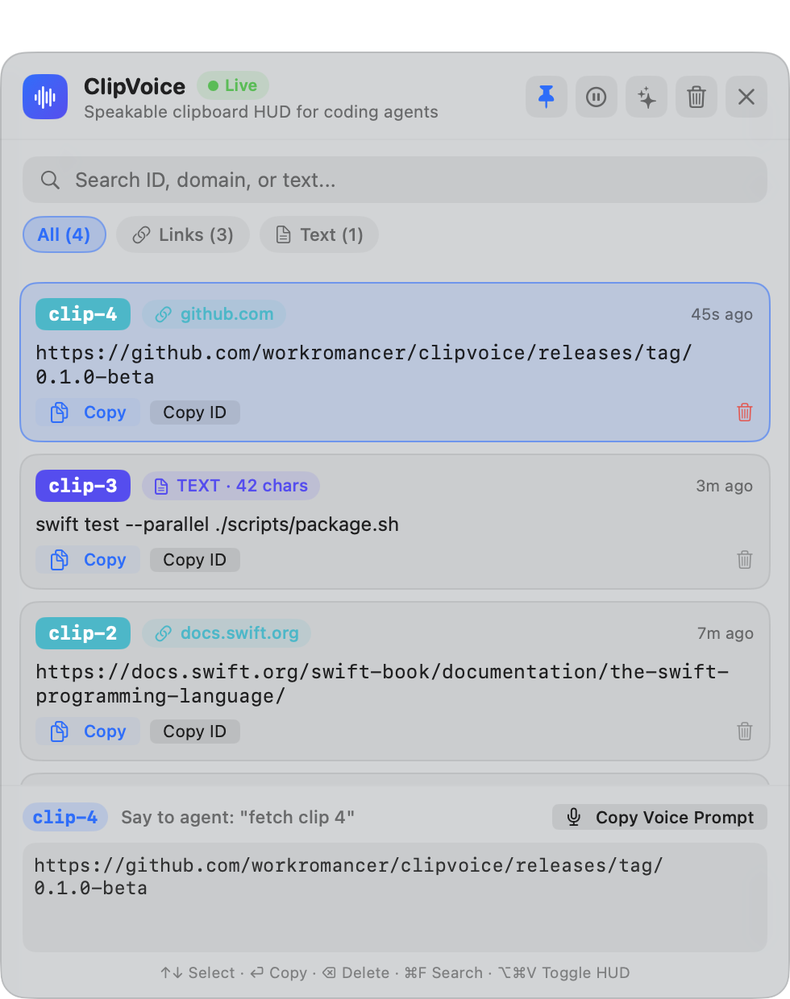

# ClipVoice (`0.1.0-beta`)

**Extend your clipboard with voice mode for coding agents.**

ClipVoice is a native macOS floating HUD, menu-bar utility, local stdio MCP server, CLI, and installable agent skill that gives every captured clipboard entry a **stable speakable ID** (`clip-1`, `clip-2`, ...).

When you are dictating to a coding agent in voice mode (Wispr Flow, Superwhisper, Mac Dictation, Codex/Claude voice mode), you no longer have to read long URLs aloud or guess which item was "the second one": glance at the floating HUD and say *"fetch clip 4"* or *"use the link in clip twelve"*.



---

## Key Features

- **Stable Speakable Identifiers (`clip-1`, `clip-2`, ...)**: Every newly captured item gets a monotonic ID that **never shifts** when newer items arrive or when an existing item is re-copied and bumped to the top (newest-first).
- **Voice-Friendly Lookup**: Agents and `clipvoice-cli` resolve canonical (`clip-12`), spaced (`clip 12`), numeric (`12`), and spoken number forms (`clip twelve`, `clip twenty four`).
- **Floating Non-Activating HUD**: Translucent native `NSPanel` floating over your terminal or IDE without stealing focus while you speak, with Always-on-Top pin, search (`⌘F`), `All` / `Links` / `Text` tabs, inspector preview, and keyboard navigation (`↑`/`↓`, `⏎` Copy, `⌫` Delete, `Esc` Hide).
- **URL vs. Text Distinction**: Cleanly separates `http`/`https` links (showing domain chips like `github.com` or `localhost:3000`) from text/code snippets.
- **Menu Bar & Global Shortcut**: `NSStatusItem` quick menu + global `⌥⌘V` shortcut to toggle the HUD, plus Pause/Resume, Copy, Delete, and Clear History controls.
- **Local Stdio MCP Server + CLI + Agent Skill**: Exposes `list_clips`, `get_clip`, `search_clips`, and `get_latest_clip` over local stdio JSON-RPC 2.0, alongside `clipvoice-cli` and `SKILL.md`.
- **Multi-Language Support (i18n)**: Localized in English (`en`) and Korean (`ko`).

---

## Installation

### From GitHub Releases (`0.1.0-beta`)

Download from the [ClipVoice 0.1.0-beta Release](https://github.com/workromancer/clipvoice/releases/tag/0.1.0-beta) (universal macOS binary for Apple Silicon `arm64` and Intel `x86_64`, macOS 13+):

- [ClipVoice-0.1.0-beta-macos-universal.dmg](https://github.com/workromancer/clipvoice/releases/download/0.1.0-beta/ClipVoice-0.1.0-beta-macos-universal.dmg) — Open DMG and drag `ClipVoice.app` into **Applications**.
- [ClipVoice-0.1.0-beta-macos-universal.zip](https://github.com/workromancer/clipvoice/releases/download/0.1.0-beta/ClipVoice-0.1.0-beta-macos-universal.zip) — Unzip and move `ClipVoice.app` into `/Applications`.

> **Gatekeeper Note (Ad-Hoc Signed Beta):**  
> This `0.1.0-beta` build is ad-hoc signed (not notarized with an Apple Developer ID). On first launch, macOS Gatekeeper may warn that the developer cannot be verified. To open it:
> 1. Right-click `/Applications/ClipVoice.app` and choose **Open**, **or**
> 2. Remove the quarantine attribute after installing:
>    ```bash
>    xattr -dr com.apple.quarantine /Applications/ClipVoice.app
>    ```

---

## Connecting Your Coding Agent

### 1. Local Stdio MCP Server

Add `clipvoice-mcp` to your MCP client configuration (see [examples/mcp-config.json](examples/mcp-config.json) and [examples/codex-config.toml](examples/codex-config.toml)):

**JSON (`Claude Desktop`, `Cursor`, `Antigravity`, etc.):**

```json
{
  "mcpServers": {
    "clipvoice": {
      "command": "/Applications/ClipVoice.app/Contents/MacOS/clipvoice-mcp",
      "args": []
    }
  }
}
```

**TOML (`~/.codex/config.toml`):**

```toml
[mcp_servers.clipvoice]
command = "/Applications/ClipVoice.app/Contents/MacOS/clipvoice-mcp"
args = []
```

**Exposed MCP Tools:**
- `list_clips(kind?, query?, limit?)` — List captured clips newest-first with stable IDs and previews.
- `get_clip(id)` — Fetch the exact full text or URL by stable/spoken ID (`"clip-4"`, `"clip four"`, `"4"`).
- `search_clips(query, kind?, limit?)` — Search by domain, keyword, or ID.
- `get_latest_clip(kind?)` — Fetch the most recent URL or text clip.

**Exposed MCP Resources:**
- `clipvoice://clips` — JSON index of captured entries.

### 2. Installable Agent Skill

Install the bundled [skills/clipvoice/SKILL.md](skills/clipvoice/SKILL.md) so your agent knows how to interpret spoken clip IDs automatically:

```bash
# Codex
/Applications/ClipVoice.app/Contents/MacOS/clipvoice-cli install-skill --target codex

# Claude Code
/Applications/ClipVoice.app/Contents/MacOS/clipvoice-cli install-skill --target claude

# Shared agents directory
/Applications/ClipVoice.app/Contents/MacOS/clipvoice-cli install-skill --target agents
```

### 3. CLI Usage

```bash
CLIPVOICE="/Applications/ClipVoice.app/Contents/MacOS/clipvoice-cli"

"$CLIPVOICE" list --kind url
"$CLIPVOICE" get clip-4 --raw
"$CLIPVOICE" get "clip four" --json
"$CLIPVOICE" search github
"$CLIPVOICE" latest --kind url --raw
```

Both `clipvoice-cli` and `clipvoice-mcp` accept `--store <path>` or `CLIPVOICE_STORE_PATH` for isolated testing.

---

## Architecture

ClipVoice is a pure-Swift multi-target package with zero third-party or paid dependencies:

- `Sources/ClipVoiceCore` — Models, URL/text classifier (`ClipClassifier`), voice-tolerant ID resolver (`SpeakableID`), pasteboard privacy filter (`PasteboardPrivacyFilter`), atomic `0600` JSON persistence (`ClipStore`), and `en`/`ko` localization (`L10n`).
- `Sources/ClipVoiceMCP` — Local stdio JSON-RPC 2.0 MCP protocol server (`ClipVoiceMCPServerHandler`).
- `Sources/ClipVoiceApp` — Native AppKit + SwiftUI floating HUD (`FloatingHUDPanel`, `HUDView`, `SetupSheetView`), pasteboard polling monitor (`ClipboardMonitor`), Carbon global hotkey (`GlobalHotKeyManager`), and menu-bar controller (`StatusBarController`).
- `Sources/ClipVoiceCLI` — `clipvoice-cli` CLI binary (`list`, `get`, `search`, `latest`, `mcp`, `install-skill`).
- `Sources/ClipVoiceMCPServer` — Dedicated `clipvoice-mcp` stdio executable.

---

## Privacy & Security

- **Local-Only App & MCP Bridge**: ClipVoice itself makes zero outbound network calls and never uploads clipboard contents automatically.
- **Agent / Provider Data Handling**: When you explicitly ask a connected coding agent or MCP client to retrieve a clip (`get_clip` / `list_clips` / `clipvoice-cli`), the retrieved entry enters that agent's context and is handled according to that agent and LLM provider's privacy/data policies (which may include cloud transmission when using hosted models).
- **Plaintext Local Storage & Permissions**: Local history is stored on disk as **plaintext JSON** (not encrypted at rest) at `~/Library/Application Support/ClipVoice/history.json`, protected with `0600` POSIX file permissions (`0700` directory permissions) and atomic writes.
- **Sensitive Pasteboard Exclusion**: Automatically ignores entries tagged with `org.nspasteboard.TransientType`, `org.nspasteboard.ConcealedType`, `org.nspasteboard.AutoGeneratedType`, `com.agilebits.onepassword`, and `com.apple.security.concealed`.
- **Caps, No Auto-Open, No Shell Execution**: History length is capped (default 50, configurable 25–200) and individual payloads are capped at 512 KB. Clipboard URLs are never fetched, resolved via DNS, or opened automatically, and clipboard text is never executed in a shell.
- **Pause & Clear Anytime**: Pause capture from the HUD or menu bar at any time, or delete individual/all items immediately.

---

## Building & Testing from Source

Requirements: macOS 13+ with Xcode / Swift 6 toolchain.

```bash
# Run unit & MCP protocol tests
swift test

# Build universal (arm64 + x86_64) ClipVoice.app
./scripts/build.sh

# Build distributable ZIP & DMG into dist/ (audits for leaked paths)
./scripts/package.sh

# Run isolated end-to-end verification (real app + pbcopy + AX automation + CLI + MCP)
./scripts/e2e_test.sh
```

See [docs/TEST_EVIDENCE.md](docs/TEST_EVIDENCE.md) for recorded verification results.

---

## License

MIT License — see [LICENSE](LICENSE).
